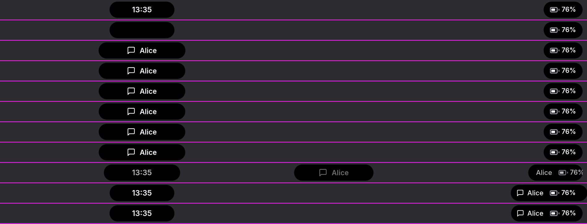
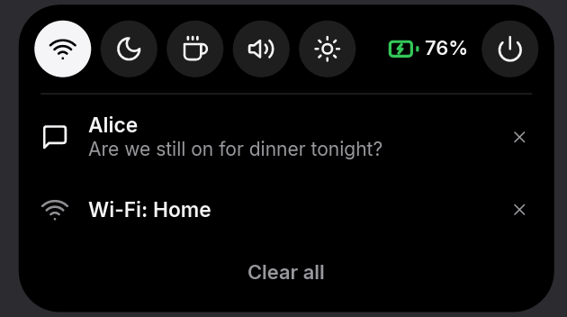
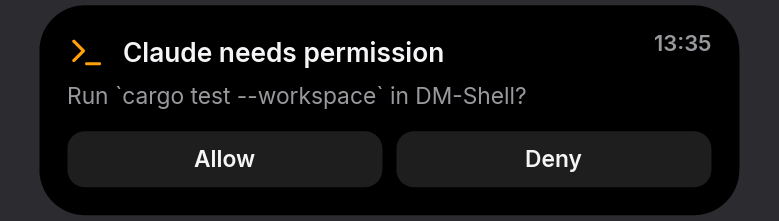
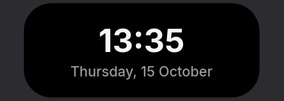

# dmsh

A minimal dynamic-island shell for [niri](https://github.com/YaLTeR/niri): two black pills
at the top of every monitor that show only what is relevant right now — and nothing
when nothing is.


- **Center island** — the one thing that matters now: the clock when idle, a
  notification as it arrives, a volume or brightness change, a running build, an agent
  asking for permission, the song that's playing.
- **Right island** — the ambient things: notifications waiting to be read, the system
  tray, the battery, and quick controls.

A notification lands in the center, then flies over to the right island:



dmsh is one small Rust program, not a toolkit: about 14 MB of memory, zero CPU while
nothing changes (it only draws while something moves), and a JSON socket so scripts and
AI agents can put things on the islands and wait for answers.

## Features

- **Notifications** (`org.freedesktop.Notifications`) with app icons and images
  (avatars), actions, urgency and replace ids; markup is cleaned to plain text. A
  scrollable list on the right island with per-item dismiss and "Clear all".
- **On-screen displays** for volume, brightness and keyboard layout.
- **Media** (MPRIS): what's playing, with previous / play-pause / next when expanded.
- **System tray** (StatusNotifierItem) with app menus shown inside the island.
- **Battery** always on the right island; a critical battery also takes the center.
- **Quick controls**: Wi-Fi on/off, do not disturb (notifications skip the center unless
  critical) and "Keep awake".
- **Volume and brightness**: quick-control buttons that open a slider (drag, scroll or
  arrow keys); hold the volume one to mute.
- **Session menu**: the power button opens Shut down · Reboot · Log out; hold one until
  it fills to run it, so a stray click never logs you out.
- **niri integration**: focused-monitor awareness, keyboard-layout and screencast
  indicators, keybind toggles with full keyboard navigation.
- **Hover to expand**, click to act; spring animations throughout.
- **Live-reloaded KDL config**: colors, font, sizes, clock format, animation, monitors.
- **For agents**: Claude Code hooks (status and Allow/Deny permission prompts in the
  island) and an MCP server (show status, notify, ask the user).
- **Scriptable**: push activities, add buttons, `--wait` for the clicked answer, stream
  events, render headlessly to PNG.

| Expanded right island | An agent asking | Media | Idle, expanded |
|---|---|---|---|
|  |  |  |  |

## Scope

dmsh is the shell for a **bare niri config** (or your own). It doesn't expect any other
shell or desktop layer. Desktop pieces — polkit agent, lock screen and idle policy,
wallpaper, clipboard history, launcher, screenshot tools — are deliberately out of
scope; pick the tools you like for those.

## Requirements

- **niri**. The focused-monitor, keyboard-layout and screencast features use niri's IPC.
  Other compositors with layer-shell may show the islands, but that's untested.
- **fontconfig** (`fc-match`, `fc-list`). [Inter](https://rsms.me/inter/) is used if
  installed, else your sans-serif; a color emoji font (e.g. Noto Color Emoji) for emoji.
- A D-Bus session bus. Optional, per feature:
  - PipeWire with `pipewire-pulse` (`pactl`, `wpctl`) — volume OSD
  - UPower — battery
  - NetworkManager — Wi-Fi messages and the Wi-Fi toggle
  - systemd-logind — clock refresh after suspend

Missing optional services just switch that feature off (dmsh logs a warning).

## Install

```bash
git clone https://github.com/Kexfff/DM-Shell && cd DM-Shell
./install.sh
```

[`install.sh`](install.sh) does three things and nothing else:

1. **Dependencies** — fontconfig, libxkbcommon and Rust (pacman, apt or dnf), and offers
   the optional ones for volume, battery and Wi-Fi.
2. **The binary** — builds it and installs `~/.local/bin/dmsh` (`--prefix` to change).
3. **The niri snippet** — writes `~/.config/niri/dmsh.kdl` (autostart and keybinds) and
   adds `include "dmsh.kdl"` to your `config.kdl`. Keys you already use are left alone
   (dmsh's bind for them is commented out), and the result is checked with
   `niri validate`.

It asks before touching anything outside the repo; `--yes` skips the questions,
`--no-deps` skips packages, and `./install.sh --uninstall` removes the binary, the
snippet and the include line again.

Only one notification daemon can run at a time: stop mako, swaync or another shell's
notifications (dmsh also takes over when they exit).

<details>
<summary>Installing by hand</summary>

```bash
cargo install --path crates/dmsh
~/.cargo/bin/dmsh niri > ~/.config/niri/dmsh.kdl
echo 'include "dmsh.kdl"' >> ~/.config/niri/config.kdl
```

niri starts programs with its own `PATH`, which usually doesn't include `~/.cargo/bin`,
so the snippet refers to dmsh by its full path. To use `dmsh` in a terminal, add the
directory to your `PATH` (fish: `fish_add_path ~/.cargo/bin`). Instead of niri's
autostart you can use the systemd unit [`dist/dmsh.service`](dist/dmsh.service)
(not both).

</details>

## With AI agents

dmsh shows what your agents are doing and lets them ask you things in the island.

**Claude Code:** session status (working, needs input, done) and permission prompts you
answer with Allow / Deny right in the island:

```bash
dmsh claude-code --apply
```

**Any MCP client:** tools to show status, notify and ask you a question:

```bash
claude mcp add --transport stdio dmsh --scope user -- ~/.local/bin/dmsh mcp
```

Scripts can do the same from the shell (`dmsh activity push … --wait`). See
[docs/agents.md](docs/agents.md).

## Try it

With dmsh running:

```bash
dmsh activity push --id hello --title "Hello from dmsh" --icon bell
```

```bash
dmsh activity push --id build --title "cargo build" --progress 0.4 --icon terminal --placement center
```

```bash
dmsh activity push --id ask --title "Deploy to production?" --placement center --action yes:Deploy --action no:Cancel --wait
```

The last one waits until you click a button and prints its key. `dmsh state` shows
what the islands display, as JSON.

## Using it

- **Hover** an island to expand it; **click** buttons, notifications, tray icons
  (right click for the app's menu, middle click for its secondary action).
- **Keybinds**: `dmsh toggle right` / `dmsh toggle center` open an island with keyboard
  focus — arrows or `j`/`k` to move, Enter to activate, Delete to dismiss, `m` for a
  tray menu, Esc to close. See [docs/niri.md](docs/niri.md).
- **Configure** in `~/.config/dmsh/config.kdl`; it reloads on save. Start from
  `dmsh config default`. See [docs/configuration.md](docs/configuration.md).

## Documentation

- [Configuration](docs/configuration.md) — every option, live reload, errors
- [niri integration](docs/niri.md) — autostart, keybinds, keyboard navigation
- [Command line](docs/cli.md) — every command and option
- [Scripts and agents](docs/agents.md) — Claude Code, MCP, activities, `--wait`, events
- [IPC protocol](docs/ipc.md) — the JSON socket, for any language
- [Design](DESIGN.md) — architecture, rendering model, decisions

## Development

```bash
cargo test
```

```bash
cargo run -- render --activities fixture.json --at 2500ms --filmstrip 200ms -o frames.png
```

`sh docs/render-images.sh` regenerates the README screenshots from
[`docs/fixtures/`](docs/fixtures).

The workspace has four crates:

| Crate | What it does |
|---|---|
| `dmsh-core` | Pure logic: activities and the arbiter, layout, springs, config, IPC types. No I/O. |
| `dmsh-render` | Drawing with tiny-skia and cosmic-text; text, icons, tray images. |
| `dmsh-sources` | Event sources on their own thread: niri, D-Bus services, audio, backlight. |
| `dmsh` | The binary: Wayland client, IPC server, CLI, headless renderer. |

`dmsh render` runs the real layout and animation code on a simulated clock, so changes
can be checked as images without a display — the screenshots in this README are made
that way (see [docs/agents.md](docs/agents.md#headless-rendering)).

## License

GPL-3.0-or-later. See [LICENSE](LICENSE).
