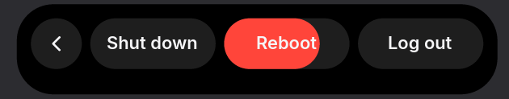

# Configuration

dmsh reads `~/.config/dmsh/config.kdl` (or `$XDG_CONFIG_HOME/dmsh/config.kdl`, or the
file given with `--config <path>`). Without a file, everything uses the defaults.

```bash
dmsh config default > ~/.config/dmsh/config.kdl
```

That writes the documented defaults; delete what you don't change.

## Reloading and errors

- **Saving the file reloads it.** dmsh watches the directory, so editors that replace
  the file on save work too. `dmsh reload` reloads by hand.
- **Mistakes don't break anything.** An invalid file keeps the previous config, and a
  "Config error" with the line number appears in the center island for 10 seconds.
- **Check without running:**

  ```bash
  dmsh config check
  ```

  It prints `ok` or the first error, e.g. `line 3: unknown theme option 'pill-heigth'`.
- **Parsing is strict.** Unknown sections, unknown options and bad values are errors, so
  a typo never silently does nothing.
- **Syntax:** [KDL](https://kdl.dev). Both KDL v2 (`#true`) and v1 (`true`, the syntax
  niri's own config uses) work.
- **Applied live:** theme, font, animation, outputs, timings and clock formats.
  **Needs a restart:** turning sources on or off.

## `theme`

```kdl
theme {
    font "Inter"
    pill-color "#000000"
    text-color "#f5f5f7"
    secondary-text-color "#98989d"
    accent-colors low="#8e8e93" normal="#f5f5f7" high="#ff9f0a" critical="#ff453a"
    reserved-height 36
    pill-height 30
    corner-radius 26
    center-idle-width 120
    center-min-width 160
    center-expanded-width 400
    right-expanded-width 340
    right-margin 8
}
```

| Option | Default | Meaning |
|---|---|---|
| `font` | unset | UI font family. Unset uses Inter if installed, else your sans-serif. |
| `pill-color` | `#000000` | The islands' fill. |
| `text-color` | `#f5f5f7` | Titles and the clock. |
| `secondary-text-color` | `#98989d` | Bodies, dates, counters. |
| `accent-colors` | see above | Icon colors by activity priority (`low`, `normal`, `high`, `critical`); also the low (high) and critical battery colors. |
| `reserved-height` | `36` | Space reserved at the top of each output; windows tile below it. `0` reserves nothing. |
| `pill-height` | `30` | Collapsed island height; must fit in `reserved-height`. |
| `corner-radius` | `26` | Corner radius of expanded islands (collapsed pills are fully round). |
| `center-idle-width` | `120` | Center island width when showing the clock. |
| `center-min-width` | `160` | Narrowest the center gets when showing an activity. |
| `center-expanded-width` | `400` | Width of the expanded center island. |
| `right-expanded-width` | `340` | Width of the expanded right island. |
| `right-margin` | `8` | Gap between the right island and the screen edge. |

Colors are `"#rrggbb"` or `"#rrggbbaa"`. Sizes are logical pixels.

## `clock`

```kdl
clock {
    format "%H:%M"
    date-format "%A, %-d %B"
}
```

[strftime](https://docs.rs/chrono/latest/chrono/format/strftime/index.html) formats for
the idle clock and for the date shown when the idle center expands. For a 12-hour
clock, use `format "%I:%M %p"`. Invalid formats are reported as config errors.

## `animation`

```kdl
animation {
    response 0.42
    damping 0.78
    // off
}
```

| Option | Default | Meaning |
|---|---|---|
| `response` | `0.42` | Seconds per spring oscillation; lower is snappier. |
| `damping` | `0.78` | `1.0` means no overshoot; lower bounces more. |
| `off` | — | Snap to the final state instead of animating. |

## `outputs`

```kdl
outputs {
    only "eDP-1"
    // except "HDMI-A-1"
}
```

Which monitors get islands, by connector name (`niri msg outputs` lists them). With
neither option, every monitor gets islands. Changes apply live: islands appear or
disappear as you save.

## `sources`

```kdl
sources {
    notifications true
    tray true
    media true
    volume true
    brightness true
    power true
    network true
    keyboard-layout true
    screencast true
    microphone true
    camera true
    weather true
    bluetooth true
}
```

Turns event sources on or off; all are on by default. A bare name means `true`
(`tray` alone turns it on). Changes take effect after restarting dmsh.

| Source | What it does |
|---|---|
| `notifications` | Run the notification daemon. Turn off to keep another one (mako, swaync). |
| `tray` | System tray icons and menus on the right island. |
| `media` | What's playing (MPRIS) and media controls. |
| `volume` | Volume and microphone OSDs, buttons and sliders. Needs `pactl` and `wpctl`. |
| `brightness` | Brightness OSD, and the brightness button and slider (when there is a backlight). |
| `power` | Battery indicator, charger messages, low and critical warnings. |
| `network` | Wi-Fi connect/disconnect messages and the Wi-Fi toggle. |
| `keyboard-layout` | OSD when the keyboard layout changes (niri). |
| `screencast` | A red screen icon on the right island while a niri screencast is active ("Screen is being shared" for a few seconds when it starts). |
| `microphone` | An orange microphone icon while an app records from a microphone (not from a speaker's monitor), via `pactl`. |
| `camera` | A green camera icon while an app has a camera (`/dev/video*`) open. |
| `bluetooth` | "Headphones connected · 80%" / "… disconnected" on the right island, and a warning when a device's battery drops to 15%, via BlueZ. |
| `weather` | The current temperature before the battery, from [wttr.in](https://wttr.in) via `curl`. See [`weather`](#weather). |

## `timing`

```kdl
timing {
    osd "1500ms"
    status "4s"
    notification-center "2s"
}
```

| Option | Default | Meaning |
|---|---|---|
| `osd` | `1500ms` | How long volume, brightness and layout overlays stay. |
| `status` | `4s` | How long right-island status messages (Wi-Fi, charger) stay. |
| `notification-center` | `2s` | How long a notification stays in the center before moving right. |

Durations take a unit: `ms`, `s` or `m`.

## `weather`

```kdl
weather {
    location "Berlin"
    units "celsius"
    interval "20m"
}
```

| Option | Default | Meaning |
|---|---|---|
| `location` | unset | A place [wttr.in](https://wttr.in/:help) understands: a city, `~Eiffel Tower`, an airport code, `55.75,37.62`. Unset, wttr.in guesses from your IP address (a VPN moves it). |
| `units` | `auto` | `celsius`, `fahrenheit`, or `auto` (the place's usual units). |
| `interval` | `20m` | How often to check; at least `1m`. |

The temperature shows as e.g. `11°` before the battery. It's fetched with `curl`; while
it can't be (offline, wttr.in down, an unknown place) the last reading stays up to an
hour, then nothing is shown, and it retries every 2 minutes. Each check sends wttr.in
your IP address (and the location, if set); turn it off with `weather false` under
`sources`.

## `session`

The power button in the expanded right island opens the session menu. Each option runs
when held (mouse button or Enter) until it fills up; letting go, or sliding off it,
cancels.



```kdl
session {
    hold "800ms"
    poweroff "systemctl poweroff"
    reboot "systemctl reboot"
    logout "niri msg action quit --skip-confirmation"
}
```

| Option | Default | Meaning |
|---|---|---|
| `hold` | `800ms` | How long to hold an option before it runs. |
| `poweroff` | `systemctl poweroff` | Command for Shut down. |
| `reboot` | `systemctl reboot` | Command for Reboot. |
| `logout` | `niri msg action quit --skip-confirmation` | Command for Log out. |

Commands run with `sh -c`, so pipes and `&&` work (e.g. saving something before
`systemctl poweroff`).

## Previewing a theme without running it

`dmsh render` draws the islands with a config's theme into a PNG:

```bash
dmsh --config ~/.config/dmsh/config.kdl render --battery 76 --background '#2c2c30' -o preview.png
```

See [docs/agents.md](agents.md#headless-rendering) for the other render options.
